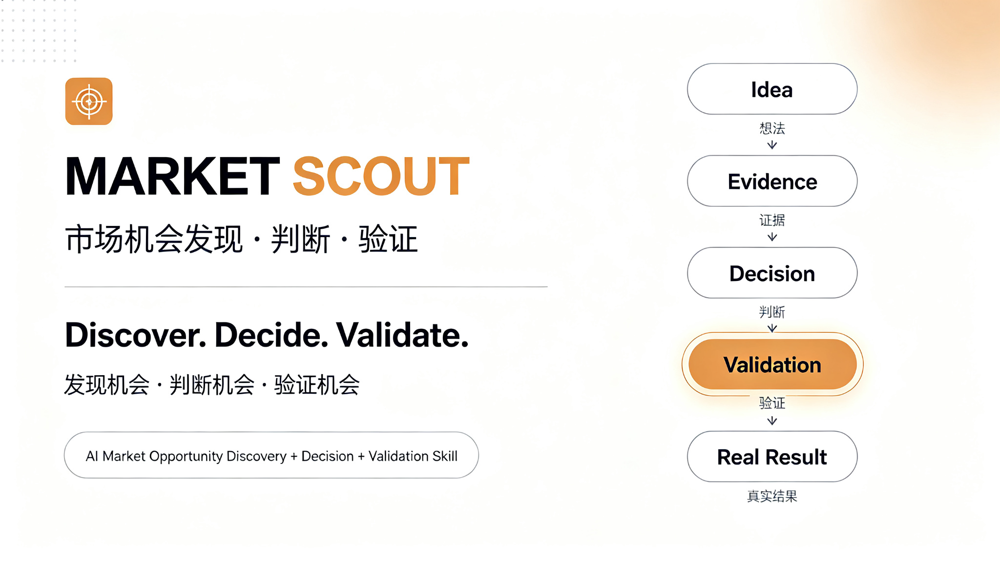
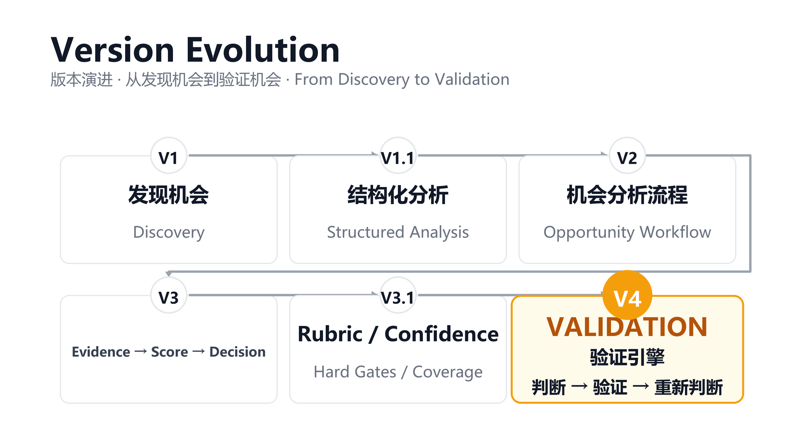
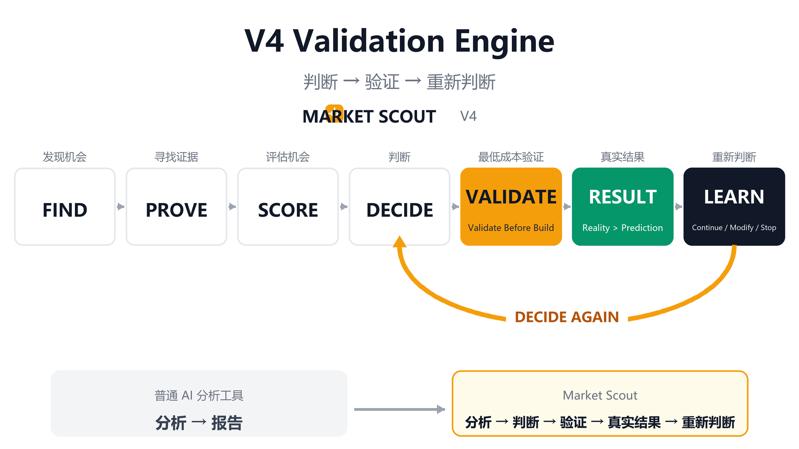

# 🔭 Market Scout

**AI Market Opportunity Discovery + Decision + Validation Skill**

**一个帮助你发现市场机会、判断机会、并用最低成本验证机会的 AI Skill。**

**Discover. Decide. Validate.**

[⬇ 下载 V4.0.0](./releases/market-scout-v4.0.0.zip) · [安装](#-安装) · [快速开始](#-快速开始) · [V4 核心](#-v4-validation-engine-验证引擎) · [版本演进](#-版本演进) · [项目结构](#-项目结构)

---

## Have an idea? Market Scout helps you / 你有一个想法？Market Scout 帮你：

**英文 / English**

`BT`
Discover opportunities
→ Find evidence
→ Score the opportunity
→ Make a decision
→ Design the lowest-cost validation
→ Feed real-world results back
→ Re-evaluate
`BT`

**中文 / 中文**

`BT`
发现机会
→ 找证据
→ 评估
→ 判断
→ 设计最低成本验证
→ 输入真实结果
→ 重新判断
`BT`

> 不要只分析机会，去验证它。**Don't just analyze opportunities. Validate them.**

## What is Market Scout? / 它是什么？

Market Scout is an AI Skill for discovering, evaluating, and validating market opportunities — it turns a vague idea into an evidence-backed decision and a lowest-cost validation plan.

Market Scout 是一个用于**发现、判断和验证市场机会**的 AI Skill：把一个模糊想法，变成有证据支撑的判断，和可以直接执行的验证计划。

它不是「AI 创业点子生成器」，不会凭空给你编项目；它也不会停在"一份分析报告"——它带着你**用最低成本去证明这件事**，再根据真实结果重新判断。

---

## 🗺 版本演进 / Version Evolution

Market Scout 是怎么成长起来的（**V4 是当前阶段最终版**）：

### V1 — Opportunity Discovery
发现市场机会。**发现机会。**

### V1.1 — Structured Analysis
让机会分析更加结构化。**结构化分析。**

### V2 — Opportunity Workflow
形成完整的机会分析流程（Validate / Evaluate / Blueprint / Monetize）。**机会分析流程。**

### V3 — Evidence → Score → Decision
开始真正基于证据进行评分和决策。**证据 → 评分 → 决策。**

### V3.1 — Rubric + Confidence + Hard Gates
解决评分可靠性、置信度、关键门槛和证据覆盖问题。**可靠性强化层。**

### 🧪 V4.0 — Validation Engine（当前版本 ⭐）
从"判断机会"进入"验证机会"。**验证引擎。**

---

## 🧪 V4 Validation Engine 验证引擎（当前版本）

**V3.1 回答：这个机会怎么样？**

**V4 回答：那我怎么用最低成本证明它？**

验证完成之后，继续？修改？暂停？放弃？—— 都由真实结果说了算。

### V4 的核心能力 / Core Capabilities

#### Validation Plan 验证计划

告诉你：

- 验证什么（core hypothesis，来自最大的未知）
- 找谁（target user）
- 怎么验证（method + channel）
- 需要多少样本（sample size）
- 需要多久（duration）
- 成功标准是什么（success criteria）
- 失败标准是什么（failure criteria）

#### Lowest-Cost Validation 最低成本验证

不会默认让你先开发 MVP —— 根据最大的未知选择最低成本方法：

`BT`
User Interview → Landing Page / Demo → Offer / Pre-sale → Manual + AI Delivery → Small Pilot → MVP
`BT`

核心原则：**Validate Before Build（先验证，再构建）**

#### Validation Result 验证结果

用户完成真实验证后，把结果重新交给 Skill：

`BT`
20 users
8 interested
3 trials
1 paid
¥99 revenue
`BT`

真实结果会被按 **Observed / Inference / Unknown** 分级，不会把"8 个人感兴趣"当成"市场已验证"。

#### Re-evaluation 重新评估

Market Scout 根据真实结果重新计算：

`BT`
Score
Confidence
Evidence Coverage
Decision
`BT`

并输出：**Continue（继续）/ Modify（修改）/ Stop（停止）/ Revisit（重查）**

> **Market Scout does not stop at prediction. It closes the loop with real-world validation.**
> **Market Scout 不停留在预测，而是通过真实验证把判断闭环。**

---

## 一个简单的使用流程 / How it works

`BT`
你有一个想法
↓
不知道有没有市场
↓
Market Scout 找证据
↓
判断这个机会
↓
找到最大的未知
↓
设计最低成本验证
↓
你去现实中验证
↓
把结果交回来
↓
Market Scout 重新判断
`BT`

## 核心链路 / Core Loop

`BT`
FIND → PROVE → SCORE → DECIDE → VALIDATE → RESULT → LEARN
`BT`

---

## 核心能力总览 / Features

| 能力 | 一句话 |
|---|---|
| **Market Research 市场研究** | 三类搜索（问题 / 现有方案 / 付费行为），用真实证据代替直觉 |
| **Opportunity Score 机会评分** | 7 维加权 0-100，计算式可手工复算 |
| **Score Rubric 评分细则** | 26 个子信号五档可观察标准，每个 7 分都能回答"为什么不是 8" |
| **Confidence 决策置信度** | 与评分分离的可复算可信度（Score 高 ≠ 一定推荐） |
| **Hard Gates 硬门槛** | 核心短板不能被总分掩盖（门槛 / 天花板 / 红旗三层） |
| **Evidence Coverage 证据覆盖度** | 六维覆盖度 + 关键缺口，回答"到底研究了多少" |
| **Validation Engine 验证引擎** | 设计最低成本验证 → 读真实结果 → 重新判断（V4） |

## 判断机制 / How decisions are made

Market Scout does not force every opportunity into a positive recommendation. Depending on the evidence, confidence, hard gates, and validation results, an opportunity can be `RECOMMENDED`, `POTENTIAL`, or `NOT_RECOMMENDED`.

Market Scout 不会默认把每个机会都判断为值得做，而是根据证据、置信度、关键门槛和验证结果，将机会判断为 `RECOMMENDED`、`POTENTIAL` 或 `NOT_RECOMMENDED`。

| 决策 | 含义 |
|---|---|
| 🟢 **RECOMMENDED** | 值得继续推进（当前证据支持投入） |
| 🟡 **POTENTIAL** | 证据不足，需要进一步验证（通常进入最低成本验证） |
| 🔴 **NOT_RECOMMENDED** | 当前证据不支持继续投入（停止，并说明什么新证据可以重启） |

> 重点是：**它不会为了哄你开心而硬给"值得做"。** 分数怎么算、为什么是这个结论，都会写清楚，你可以自己复核。

## 真实使用示例 / Real Example

> 演示数据，方法见 `examples/`（V4 全链示例：`examples/v4-validation-plan.md` → `v4-lowest-cost-validation.md` → `v4-validation-result.md` → `v4-re-evaluation.md`）

`BT`
INPUT: "我发现很多小商家不会做短视频，能不能做一个 AI 工具帮他们自动生成内容？"

Evidence       本地商家"不会做内容/代运营贵"的重复求助（Evidence）
Score          Opportunity Score（计算式可复算），Confidence 与 Coverage 分开展示
Hard Gate      核心门槛检查，缺付费证据 → Score Ceiling（最高 POTENTIAL）
Decision       🟡 POTENTIAL（付费未验证）
Validation     20 家目标商家 → 免费样品 → 报价 99 元/次（最低成本验证，不开发产品）
               成功标准：≥5 明确需求 且 ≥2 付款；失败标准：<2 付款
Result         20 users / 8 interested / 3 trials / 1 paid → Partial → 修改 Offer
Re-evaluation  根据真实结果重算 Score / Confidence / Coverage / Decision
`BT`

> **Market Scout 不一定告诉你"去开发这个产品"。** 它可能告诉你：**先用人工 + AI 验证 5-10 个客户是否愿意付费。** 这正是 V4 的价值。

## 输出包含什么 / Output

最终给你的不是一篇"市场分析报告"，而是一个**有证据、有约束、有验证计划、可重新判断的机会判断**：

`BT`
Opportunity Score      机会评分（可复算）
Confidence             决策置信度
Evidence Coverage      证据覆盖度 + 关键缺口
Hard Gates             硬门槛检查
Decision               三档结论 + Why
Validation Plan        验证什么 / 找谁 / 怎么验证 / 样本 / 时长 / 成本 / 成功 / 失败
Today Action           今天做什么
Fallback               失败后改什么
`BT`

---

## 🚀 安装 / Installation

> 以仓库真实安装方式为准（与 `USER_GUIDE.md` 完全一致）。纯 Markdown Skill：**不需要 npm / pip，不运行任何服务，无额外依赖。**

**方式一：拖拽一键安装（推荐）**

1. 下载并解压 [market-scout-v4.0.0.zip](./releases/market-scout-v4.0.0.zip)，取出其中的 `market-scout` 文件夹（部分客户端支持直接拖 zip）。
2. 拖入 AI 客户端的「技能 / 一键安装」入口；不支持时改用方式二。
3. 按「验证安装」确认版本。

**方式二：手动放入技能目录**

1. 解压得到 `market-scout` 文件夹。
2. 放入 AI 客户端的技能目录（通常叫 `.user_skills/` 或 `skills/`）。
3. 保证路径为 `<技能目录>/market-scout/SKILL.md`。
4. 重启或刷新客户端。

**或 Clone 本仓库**：`git clone https://github.com/kio831/market-scout.git`

> 装过旧版：V4 向下兼容、旧能力全部保留；部分平台同名目录不覆盖，建议先删除旧 `market-scout` 文件夹再安装。

**验证安装**：打开安装后的 `SKILL.md`，同时搜到 `Opportunity Score` 和 `值得继续做 RECOMMENDED` = V4.0.0；再搜到 `v4-validation.md` 与 `v4-validation-card.md` = V4 验证引擎就位。

## ⚡ 快速开始 / Quick Start

`BT`
1. Install Market Scout
2. Give it an idea / problem / observation
3. Choose Quick / Research / Execution
4. Let Market Scout analyze
5. Read Decision + Validation Plan
6. Go validate in the real world
7. Feed results back → Market Scout re-evaluates
`BT`

| 你想做什么 | 可以这样说 |
|---|---|
| 快速判断一个想法 | "学校打印店总有人让老板改 PDF，有没有机会？" |
| 分析视频 / 评论区 | "分析这个评论区，看能不能做成生意" |
| 打分与决策 | "这个想法值不值得做，打个分" / "帮我决策" |
| MVP 与下一步 | "第一版做什么？" / "下一步做什么？" |
| 设计与执行验证（V4） | "帮我验证一下这个想法" / "设计一个验证实验" / "我验证了 20 个人，3 个付费" / "把验证结果交回" / "重新评估" |

**三种工作模式**：Quick Mode（随手判断，默认，保持轻量）· Research Mode（深挖完整报告）· Execution Mode（停止研究、直接给执行清单）。

## 📚 Documentation & 项目结构 / Repository Structure

- [USER_GUIDE.md](./USER_GUIDE.md) — 用户安装与使用说明
- [CHANGELOG.md](./CHANGELOG.md) — 版本变更记录（v1.0 → v1.1 → v2.0.0 → v3.0.0 → v3.1.0 → v4.0.0）
- [CONTRIBUTING.md](./CONTRIBUTING.md) — 贡献指南

`BT`
market-scout/
├── SKILL.md                    # 核心入口：铁律、V2 流水线、V3 决策层、V3.1 强化层、V4 验证引擎
├── README.md                   # 本文件（GitHub 项目主页）
├── USER_GUIDE.md               # 用户安装与使用说明
├── CHANGELOG.md                # 版本变更记录
├── CONTRIBUTING.md / LICENSE / .gitignore
├── assets/                     # README 配图（hero / evolution / validation loop）
├── references/  (23)           # 方法论文档（V1 基础 6 + V2 流水线 6 + V3 决策层 6 + V3.1 强化层 4 + V4 验证引擎 1）
├── templates/   (17)           # 可直接填充的卡片/报告模板（含 v4-validation-card.md）
├── examples/    (13)           # 流程示例（全部为演示数据，含 4 个 V4 验证示例）
├── tools/
│   ├── validate_skill.py       # 自检脚本（397 项检查）
│   ├── test_v31_cases.py       # V3.1 规则用例测试（A-F + 矩阵）
│   └── test_v4_validation.py   # V4 验证引擎用例测试（A-G）
├── releases/
│   └── market-scout-v4.0.0.zip # ✅ V4.0.0 正式安装包
└── website/
    └── index.html              # 项目落地页（可挂 GitHub Pages）
`BT`

## 🗺 Roadmap

| 版本 | 状态 | 内容 |
|---|---|---|
| v1.0 | ✅ 已发布 | Opportunity Discovery：三类搜索、Problem Card |
| v1.1 | ✅ 已发布 | Structured Analysis：Evidence Chain、三模式、状态机 |
| v2.0.0 | ✅ 已发布 | Opportunity Workflow：Validate / Evaluate / Blueprint / Monetize |
| v3.0.0 | ✅ 已发布 | Evidence → Score → Decision：证据三态、三档决策、MVP、行动计划 |
| v3.1.0 | ✅ 已发布 | Rubric / Confidence / Hard Gates / Coverage / Evidence-driven Action |
| **v4.0.0** | **🚀 当前版本** | **Validation Engine：判断 → 最低成本验证 → 真实结果 → 重新判断** |
| 后续迭代 | 📋 规划中 | 仅针对 Bug / 稳定性 / 真实用户反馈 / 规则优化，不再新增大型功能 |

## 🤝 Contributing & License

欢迎 Issue 与 PR，流程见 [CONTRIBUTING.md](./CONTRIBUTING.md)。

[MIT](./LICENSE) © Market Scout Contributors —— 可自由使用、修改、分发，包括用于个人副业探索与商业项目。

---

> **我有一个想法 → Market Scout 帮我找证据 → 评估这个机会 → 告诉我判断有多可靠 → 防止关键短板被总分掩盖 → 设计最低成本验证 → 我去现实里验证 → 把结果交回来 → 重新判断。**

#### From vague ideas to validated decisions.

**FIND → PROVE → SCORE → DECIDE → VALIDATE → RESULT → LEARN**

[⬆ 回到顶部](#-market-scout)

